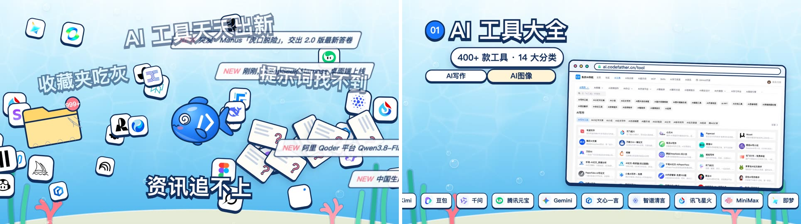
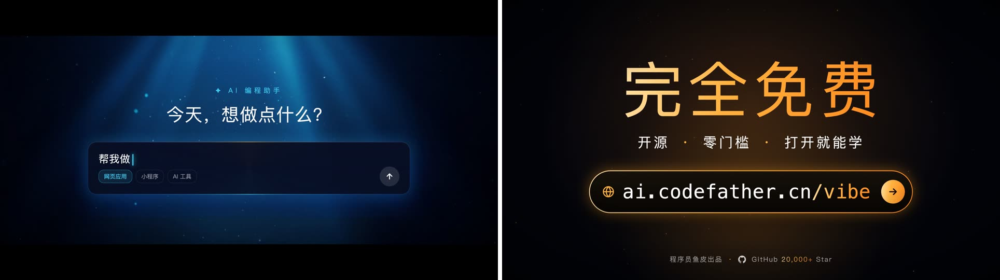
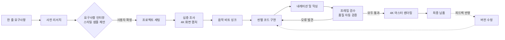

<div align="center">

# 제품 홍보 영상 제작기

**한 줄로 AI에게 무엇을 홍보할지 말하면, AI가 스스로 리서치, 질문, 4K 캡처, BGM 작곡, 내레이션 더빙, 편집, 품질 검증을 거쳐 4K 상업용 홍보 영상을 완성합니다.**

[](LICENSE)


</div>

위의 움직이는 이미지는 본 도구로 제작된 5편의 홍보 영상 오프닝 컷입니다. 동일한 도구로 제작되었음에도 스타일은 완전히 다릅니다. 개발자 학습 커뮤니티는 라이트 톤 등각 투영(아이소메트릭) 3D 지도, 개발자 면접 플랫폼은 흑백 열혈 만화, AI 내비게이션 사이트는 화사한 수중 Q버전 캐릭터, 미출시 AI 모델 프리뷰는 기밀 유출 문서 스타일, 노코드 입문 튜토리얼은 웅장한 시네마틱 트레일러로 구현되었습니다. 이러한 비주얼은 고정된 템플릿에서 나온 것이 아니라, AI가 각 제품의 특성에 맞춰 차별화된 콘셉트를 제시하고 샘플 프레임을 렌더링한 후 제작자가 직접 선택한 결과입니다.

## 제품 소개

제대로 된 완성도의 상업용 홍보 영상을 제작하려면 기획 대본 작성, 시각 소재 확보, 화면 디자인, 비트 매칭 컷 편집, 오디오 더빙 및 사운드 마스터링 등 수많은 전문 공정을 거쳐야 합니다. 전문 외주를 맡기면 수백만 원에서 수천만 원의 비용이 발생하고, 직접 만들려면 복잡한 영상 편집 툴을 새로 배워야 합니다.

본 프로젝트는 이 모든 영상 제작 파이프라인을 AI가 이해하고 자율 실행할 수 있는 작업 규약(`AGENTS.md`)으로 정립하고, Remotion 기반 영상 엔지니어링 템플릿과 십여 종의 자동화 스크립트를 결합했습니다. 로컬 저장소를 클론하여 Cursor, Claude Code, Codex 같은 AI 코딩 에이전트로 열 수도 있고, 단일 Skill로 설치하여 원하는 프로젝트 작업공간에서 호출할 수도 있습니다. 어떤 방식을 선택하든 사용자는 "어떤 제품의 홍보 영상을 만들지" 한 줄로 설명하기만 하면 됩니다. 제품의 차별화 포인트 발굴, 어울리는 스타일 제안, 시청자를 사로잡을 연출 등 불확실한 요소들은 AI가 사전에 심층 조사한 뒤 명확한 선택지를 마련해 질문합니다.

여기서 '제품'의 범주는 매우 넓습니다. 웹사이트, 모바일 앱, SaaS 도구, 오픈소스 프로젝트, 온라인 강의 및 튜토리얼, AI 모델, 커뮤니티, 오프라인 이벤트 등 화면으로 보여줄 수 있는 인터페이스나 결과물이 있다면 무엇이든 제작할 수 있습니다.

## 빠른 시작

제작 환경에는 Node.js 18 이상, Python 3.9 이상, 그리고 ffmpeg이 필요합니다. 먼저 컴퓨터에 이 세 가지 도구가 설치되어 있는지 확인해 주세요. 나머지 Python 패키지와 웹페이지 캡처용 브라우저 엔진은 AI가 작업 시작 전 환경 진단을 수행할 때 설치를 안내합니다.

다음 두 가지 사용 방식 중 하나를 선택할 수 있습니다. 가볍게 테스트해 보거나 홍보하려는 제품의 로컬 소스코드가 없는 경우 저장소를 직접 클론하는 것이 간편합니다. 반대로 자체 제품 저장소 안에서 "이 프로젝트 홍보 영상 만들어줘"라고 상시 호출하고 싶다면 Skill로 설치하세요.

### 1. 저장소 클론 후 직접 사용

저장소를 로컬에 복제한 뒤 Python 의존성과 캡처용 브라우저 바이너리를 설치합니다.

```bash
git clone https://github.com/liyupi/ai-promo-video-maker.git
cd ai-promo-video-maker
pip install -r template/requirements.txt
playwright install chromium
```

필수 환경이 갖추어져 있는지 확실하지 않다면 진단 스크립트를 실행해 보세요. 시스템에 임의로 설치하지 않고 점검만 수행하며, 누락된 항목과 설치 명령어를 정확히 알려줍니다.

```bash
python3 template/scripts/doctor.py
```

점검 완료 후 Cursor, Claude Code 등 선호하는 AI 코딩 도구로 이 디렉터리를 열고 작업을 시작하면 됩니다. 완성된 영상은 `outputs/<프로젝트명>/` 디렉터리에 생성됩니다.

### 2. Skill로 설치하여 사용

본 저장소는 표준 Agent Skill 규격을 지원하므로, [skills](https://github.com/vercel-labs/skills) CLI를 통해 Claude Code, Cursor, Codex 등에 원클릭으로 설치할 수 있습니다. `-g` 옵션을 붙여 전역 설치하면 모든 프로젝트에서 활용할 수 있습니다.

```bash
npx skills add liyupi/ai-promo-video-maker -g
```

설치 후에는 어떤 프로젝트에서든 AI에게 "이 프로젝트를 위한 홍보 영상을 제작해줘"라고 명령하면 이 스킬이 자동으로 트리거됩니다. 이 방식은 제품 소스코드 저장소 내부에서 작업할 때 특히 강력합니다. AI가 소스코드, 기술 문서, README를 직접 읽어 가장 정확한 1차 팩트와 소재를 수집할 수 있기 때문입니다. 결과물은 현재 작업공간의 `홍보영상/` 디렉터리에 저장되며, 대용량 파일이 Git에 커밋되지 않도록 `.gitignore` 추가를 자동으로 안내합니다. 최신 버전 업데이트는 `npx skills update`로 가능합니다.

### ElevenLabs 설정 (선택사항)

[ElevenLabs](https://elevenlabs.io) 계정이 있다면, 작업공간 루트에 `.env.example`을 복사하여 `.env`로 이름을 바꾼 뒤 API 키를 등록하거나 환경변수 `ELEVENLABS_API_KEY`를 설정하세요. AI가 씬별 맞춤 작곡, 효과음 생성, 프로급 AI 내레이션을 생성하며, 음성 인식(STT)으로 오독이 없는지 문장별로 자동 교정합니다.

계정이 없어도 제작에는 전혀 지장이 없습니다. 이 경우 AI가 상업적 이용이 가능한 무료 Mixkit 음원 라이브러리에서 최적의 BGM을 선별하고, 음성 내레이션 대신 시선을 끄는 감각적인 자막 타이포그래피로 연출합니다.

### 한 줄로 작업 시작하기

어떤 방식을 선택하든 시작하는 방법은 동일합니다. 동료에게 업무를 요청하듯 편안한 한 문장으로 요청하세요:

```text
https://example.com 웹사이트 홍보 영상 하나 만들어줘
```

```text
내 오픈소스 프로젝트 소개 영상을 1분 길이로 제작해줘. 저장소 주소는 https://github.com/xxx/yyy 야
```

```text
우리 가계부 앱이 다음 주에 런칭하는데, 릴스/쇼츠에 올릴 9:16 세로형 홍보 영상 제작해줘
```

요청을 받으면 AI는 먼저 몇 분간 제품을 면밀히 분석한 후, 2단계에 걸쳐 핵심 요구사항을 인터뷰합니다. 질문에는 화면비, 재생 시간, 타깃 시청자, 비주얼 스타일, 오프닝 훅 방식, 음악 및 캡처 출처 등이 포함됩니다. 각 질문마다 해당 제품에 특화된 추천 옵션과 이유가 함께 제공되므로, 고민될 때는 추천 항목을 선택하거나 "알아서 결정해줘"라고 답하셔도 좋습니다.

요구사항을 확정한 후에는 AI가 나머지 모든 공정을 전자동으로 진행합니다. 중간 과정에서는 오직 세 가지 경우(웹사이트 캡처를 위한 브라우저 로그인 필요 시, BGM/음색 최종 청취 선택 시, 사용자 본인만 확인할 수 있는 사실 관계 확인 시)에만 사용자에게 확인을 요청합니다.

### 권장 AI 모델

**Claude Opus 5.5** 또는 동급 이상의 최상위 플래그십 모델 사용을 강력히 권장합니다. 프로모션 영상 제작은 십여 단계의 복합 파이프라인과 수차례의 프레임 검수, 오디오 파형 분석을 수반하므로, 방대한 컨텍스트 속에서도 가이드라인의 규약을 일관되게 기억하고 높은 심미적 안목을 발휘할 수 있는 모델이 필요합니다. 성능이 부족한 모델은 자동 검증 단계를 임의로 건너뛰거나, 모든 제품을 개성 없는 획일적인 다크 테크 스타일로 제작하는 경향이 있습니다.

## AI가 스타일 샘플 프레임을 먼저 제안합니다

본격적인 영상 코드 작성에 앞서, AI는 제품의 특성을 반영한 3~4가지의 뚜렷이 구별되는 스타일 방향을 기획하고 각 방향별로 실제 16:9 샘플 프레임을 렌더링합니다. 사용자는 "이 스타일이 내 제품에 적용되었을 때 어떤 느낌일지" 눈으로 직접 보고 선택할 수 있습니다. 아래는 개발자 면접 플랫폼 '면접덕' 제작 당시 제안된 4가지 샘플 프레임으로, 제작자는 우측 상단의 열혈 만화 스타일을 최종 선택했습니다.


동일한 워크플로우를 AI 도구 내비게이션 플랫폼에 적용했을 때 도출된 후보군은 완전히 달랐습니다. 제작자는 로고를 모티브로 한 우측 상단의 산뜻한 수중 Q버전 캐릭터 스타일을 채택했습니다.


제안된 옵션 중 하나를 고를 수도 있고, "A의 색감에 C의 캐릭터를 조합해줘"와 같이 믹스매치할 수도 있습니다. AI는 사용자의 선택과 모든 결정 사항을 `요구사항_확인서.md`에 정리하고, 최종 승인을 받은 뒤 제작에 돌입합니다.

## 완성 영상 쇼케이스

아래 5편의 영상은 모두 본 도구를 통해 완성된 실제 결과물입니다. 각 프로젝트는 수차례의 실전 피드백을 거쳤으며, 이러한 수정 경험들이 축적되어 제작 규약의 핵심 규칙으로 자리 잡았습니다.

### 1. 프로그래밍 내비게이션: 등각 투영(Isometric) 3D 지도
학습 로드맵, 프로젝트, 면접 대비를 제공하는 개발자 커뮤니티입니다. SVG 코드로 은은한 파스텔톤의 3D 가상 도시를 구현하여 로드맵을 따라 취업 합격으로 나아가는 여정을 시각화했습니다. 세 가지 학습 페인포인트로 오프닝을 열고, 4.4초 만에 비트 폭발과 함께 브랜드가 등장하며, 로그인 후 캡처한 10장의 4K 실제 페이지로 각 기능을 입체적으로 소개합니다. 배경음악, 효과음, 내레이션 전반을 ElevenLabs로 구축했습니다.


### 2. 면접덕: 흑백 열혈 만화
개발자 면접 문제풀이 플랫폼입니다. 시그니처 오리 옐로우 컬러 하나만을 포인트로 삼은 흑백 만화풍으로 연출되었습니다. 오프닝에서 사이트 내 최다 조회수 기출문제 4개를 속도감 있게 던지며, AI 맞춤 작곡으로 두 번의 비트 드롭과 잔잔한 해설 구간을 설계했습니다. AI 생성 만화 컷에 4배 초해상도(Real-ESRGAN) 업스케일을 적용하여 4K 대화면에서도 잉크 펜선의 선명함을 유지합니다.


### 3. 위피 AI 내비게이션: 청량한 수중 Q버전
AI 도구 및 리소스 큐레이션 사이트입니다. 로고를 모티브로 한 아기자기한 물고기 마스코트가 여러 브라우저 창 사이를 헤엄치며 각 카테고리의 실제 웹페이지를 스크롤합니다. 이 프로젝트는 5차례의 피드백을 거치며 "음악은 사용자가 귀로 직접 듣고 결정해야 함", "스크린샷은 원본 종횡비를 엄수해야 함", "고유 브랜드명은 STT 단어 단위 검증을 거쳐야 함" 등의 핵심 규칙을 정립하는 계기가 되었습니다.



### 4. Claude Fable 5.5: 기밀 유출 문서
공식 발표 전 커뮤니티에서 비공식 유출 루머로 화제가 된 AI 모델의 사전 프리뷰 영상입니다. 전편에 '공식 미확인' 표기를 유지하고 모든 유출 사례를 X(구 트위터) 원문 트윗까지 추적하여 출처를 명시했습니다. 영상 말미에는 공식 발표 대기 중임을 보여주는 공식 뉴스룸 실시간 캡처를 배치했습니다.


### 5. Vibe Coding 튜토리얼: 시네마틱 트레일러
무료 AI 코딩 입문 강의를 소개하는 영상입니다. 다크 시네마틱 트레일러 무드를 채택하여 "말 한마디로 소프트웨어를 만든다"는 핵심 메시지를 전달하며, 실제 앱 UI를 레이어 컴포넌트로 분해해 화면 위에서 블록처럼 자라나듯 등장시키는 역동적인 모션을 구현했습니다.



## 템플릿 티가 나지 않는 고품질 영상을 만드는 이유

단순한 영상 생성은 어렵지 않지만, 시청자가 끝까지 몰입하고 실제로 제품을 써보고 싶게 만드는 상업적 완성도를 확보하는 것은 매우 까다롭습니다. 본 프로젝트는 다음 원칙에 집중합니다:

**진짜 제품이 주인공입니다.** 기능 소개 구간마다 실제 UI 캡처 또는 실제 작업물이 필수로 배치되며, 영상 전체에서 최소 8장 이상, 그리고 8장 이상의 고속 컷 전환 몽타주가 포함됩니다. AI 생성 이미지나 코드로 그린 그래픽은 분위기 연출과 트랜지션을 위한 포장일 뿐입니다. 내장 캡처 엔진은 웹페이지를 3840×2160 해상도의 4K 무손실 이미지로 자동 캡처하며, 로그인이 필요한 페이지도 실제 브라우저 세션을 연동하여 깨끗하게 수집합니다.

**명확한 템포 기준을 준수합니다.** "너무 빨라서 글씨를 못 읽겠다"와 "너무 늘어져서 지루하다"는 상반된 문제를 해결하기 위해 두 가지 하한선을 적용합니다. 시청자가 편안히 읽을 수 있도록 빠른 컷도 최소 0.65초, URL/CTA는 3초 이상 노출하며, 지루함을 방지하기 위해 오프닝 3초 안에 페인포인트나 핵심 강점이 등장하고 화면에 새로운 정보가 없는 상태가 2초 이상 지속되지 않도록 통제합니다.

**데이터 기반 오디오 검증을 거칩니다.** AI는 소리를 들을 수 없으므로 생성된 내레이션을 STT로 역변환하여 대본과 비교하며, 브랜드명이나 URL에 오독이 발생하면 즉시 재생성합니다. 믹싱 후에도 최종 음성을 전수 검사하여 목소리가 BGM에 묻히지 않는지(+8 dB 이상의 보컬 마진) 수치로 확인합니다. BGM과 최종 목소리 톤은 사용자가 직접 귀로 듣고 결정할 수 있도록 청취 샘플을 제공합니다.

**철저한 자동 품질 게이트를 운영합니다.** 렌더링 전 파일 누락, 저해상도 이미지, 폰트 글자 누락을 전수 검사하고, 렌더링 후에는 영상 규격, 렌더링 에러 로그, 음량(LUFS)을 점검하며 씬별 스크린샷 시트를 생성하여 시각적 결함을 검수합니다.

**실전 트러블슈팅 데이터베이스를 반영합니다.** `references/pitfalls.md`에는 60여 개의 실제 트러블슈팅 사례가 집대성되어 있으며, `references/case-studies.md`에는 각 프로젝트의 수정 이력과 해결책이 기록되어 있습니다. AI는 작업을 시작하기 전 이 경험들을 먼저 학습하여 실수를 사전에 예방합니다.

## 전체 제작 워크플로우

전체 공정은 10개 단계로 구성됩니다. 사용자가 직접 개입해야 하는 필수 지점은 요구사항 인터뷰뿐이며, 나머지 공정은 AI가 자율적으로 완수합니다.



결과물을 확인한 후 수정하고 싶은 부분이 있다면 자연어로 편하게 피드백을 전달해 주세요. AI가 피드백을 기록하고 필요한 최소 범위만 정확히 재작업합니다 (예: 내레이션 음색만 변경할 경우 비디오 렌더링을 다시 하지 않고 음향 트랙만 고속 교체).

## 프로젝트 디렉터리 구조

```text
ai-promo-video-maker/
├── AGENTS.md        # AI 작업 규약 가이드라인 (핵심 엔진)
├── SKILL.md         # Agent Skill 진입점 파일
├── CLAUDE.md        # Claude Code용 워크스페이스 설정
├── README.md        # 프로젝트 안내 설명서
├── references/      # 상세 가이드: 요구사항, 스타일, 소재, BGM, 더빙, 체크리스트, 트러블슈팅, 사례
├── template/        # 프로젝트 보일러플레이트: Remotion 엔지니어링, 웹 플레이어, 자동화 스크립트 풀세트
└── outputs/         # 클론 모드 시 최종 영상 결과물이 생성되는 디렉터리 (Git 제외)
```

각 결과물 디렉터리에는 완성된 고화질 비디오 파일뿐만 아니라 `요구사항_확인서.md`(확정된 기획안과 라운드별 수정 기록), `조사_노트.md`(팩트 및 소재 출처 목록), 즉시 웹 배포 가능한 웹 플레이어 빌드, 그리고 전체 Remotion 소스코드가 함께 패키징됩니다.

## 자주 묻는 질문 (FAQ)

**비용이 얼마나 드나요?**
본 도구 자체는 완전한 오픈소스 무료 소프트웨어입니다. 주요 비용은 사용하시는 AI 코딩 툴(Cursor, Claude Code 등)의 구독료입니다. ElevenLabs는 선택사항이며, 효과음은 무료 플랜으로도 활용 가능하지만 상업적 이용을 위해서는 유료 플랜이 필요합니다. ElevenLabs를 사용하지 않을 경우 100% 무료 상업용 Mixkit 라이브러리로 BGM을 구성합니다.

**영상 한 편을 만드는 데 시간이 얼마나 걸리나요?**
대부분의 시간은 AI가 백그라운드에서 조사, 에셋 가공, 렌더링 및 검증을 수행하는 데 사용됩니다. 사용자가 참여하는 시간은 초반 인터뷰와 중반 BGM 청취 정도입니다. 최종 4K 렌더링 시간은 그래픽 복잡도에 따라 보통 4분에서 18분 정도 소요됩니다.

**Windows와 Linux 환경도 지원하나요?**
네, 지원합니다. Windows 및 Linux 환경에서는 한글 폰트가 맑은 고딕(Malgun Gothic) 또는 Noto Sans CJK로 자동 대체 구동됩니다.

**릴스나 쇼츠용 세로 영상도 제작할 수 있나요?**
가능합니다. 요구사항 인터뷰 단계에서 화면비를 지정할 수 있으며 가로(16:9), 세로(9:16), 또는 가로/세로 동시 제작을 지원합니다.

**소재 저작권 문제는 어떻게 관리되나요?**
요구사항 인터뷰 시 저작권 허용 범위를 명확히 설정하며, 수집된 모든 소재의 원본 출처를 `조사_노트.md`에 투명하게 기록합니다. 참고로 Remotion 프레임워크 자체는 개인 및 3인 이하 소규모 기업에 무료이며, 그 이상의 기업은 [Remotion 라이선스 정책](https://www.remotion.dev/license)을 확인해야 합니다.

**스크립트 도구들만 따로 사용할 수도 있나요?**
가능합니다. `template/` 폴더는 독립적인 Remotion 프로젝트로, 비트 그리드 분석(`music.py`), 4K 웹 캡처(`shot.py`), 비디오 검증(`check_video.py`) 등 개별 스크립트만 단독으로 실행할 수 있습니다. 각 스크립트 사용법은 `AGENTS.md`에 자세히 설명되어 있습니다.

## 기여하기

본 도구로 멋진 홍보 영상을 완성하셨다면 GitHub Issue를 통해 공유해 주세요! 제작 과정에서 새로운 오류나 개선점을 발견하셨다면 `references/pitfalls.md`에 해결책을 추가하여 PR을 보내주시면 다른 사용자들의 AI 에이전트에게도 큰 도움이 됩니다.

## 감사의 글 (Acknowledgements)

본 프로젝트는 비디오 렌더링 엔진 [Remotion](https://www.remotion.dev), AI 음성 합성 및 사운드 디자인의 [ElevenLabs](https://elevenlabs.io), 상업용 무료 음원 플랫폼 [Mixkit](https://mixkit.co), 고화질 브라우저 자동화의 [Playwright](https://playwright.dev), 그리고 멀티미디어 프로세싱의 표준 [FFmpeg](https://ffmpeg.org)의 강력한 생태계 위에서 완성되었습니다.

## 라이선스

본 프로젝트는 [MIT 라이선스](LICENSE)에 따라 오픈소스로 제공됩니다.
